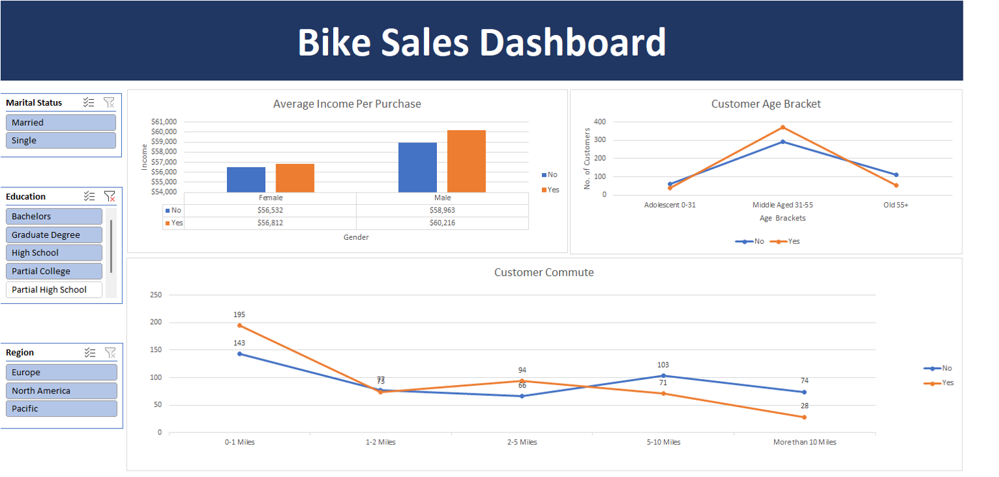

# Bike Sales Analysis (DataSource: Kaggle)

## 📌 Project Overview  

An Excel-based analysis of bike purchasing behaviour across customer demographics, income, commute distance and occupation.

## 📊 Dashboard

## 🛠 Tools & Skills Used
- Microsoft Excel
- Data Cleaning (handling nulls, formatting, standardization)
- Pivot Tables & Pivot Charts
- Data Analysis Expressions (formulas & calculated fields)
- Interactive Dashboard Design (slicers, filters, visualization)
